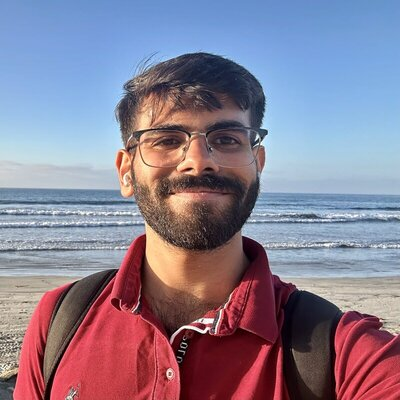

# Hi, I'm Dhruv

I'm a PhD student in Natural Language Processing at [MBZUAI](https://mbzuai.ac.ae/), advised by [Preslav Nakov](https://mbzuai.ac.ae/academics/faculty-directory/preslav-nakov) with [Tanmoy Chakraborty (IIT Delhi)](https://tanmoychak.com/) as my external co-advisor.

I work on safeguarding information integrity in the age of AI: automatic fact-checking, news media profiling, and honest, safe, and factual AI systems. My PhD research sits at the intersection of automated fact-checking and human-computer interaction, exploring how AI can help professional fact-checkers write full fact-checking articles faster.

I have also built LLMs for specialized domains and languages, including a finance LLM and [Nanda, an open-weights Hindi-English bilingual model family](https://mbzuai.ac.ae/news-events/news/building-ai-model-actually-speaks-hindi).

[Website](https://dhruvsahnan.github.io) · [Google Scholar](https://scholar.google.com/citations?user=TNJYdd8AAAAJ&hl=en) · [LinkedIn](https://www.linkedin.com/in/dhruvsahnan) · dhruv.sahnan [at] mbzuai.ac.ae

## Selected publications

- [Can LLMs Automate Fact-Checking Article Writing?](https://aclanthology.org/2026.tacl-1.23/), *TACL 2026*
- [Co-FactChecker: A Framework for Human-AI Collaborative Claim Verification Using Large Reasoning Models](https://arxiv.org/abs/2604.13706), *2026*
- [Promises and Pitfalls of Community Moderation on Social Media](https://arxiv.org/abs/2505.20067), *PNAS 2026*
- [Nanda Family: Open-Weights Generative Large Language Models for Hindi](https://aclanthology.org/2026.eacl-long.288), *EACL 2026*
- [FinChain: A Symbolic Benchmark for Verifiable Chain-of-Thought Financial Reasoning](https://aclanthology.org/2026.acl-long.662/), *ACL 2026*

The full list is on my [website](https://dhruvsahnan.github.io) and [Google Scholar](https://scholar.google.com/citations?user=TNJYdd8AAAAJ&hl=en).

## Recent news

- **Nov 2026:** Attended my first Dagstuhl Seminar on [Technology, Trust, Truth: The Role of Responsible AI in Combating Misinformation](https://www.dagstuhl.de/en/seminars/seminar-calendar/seminar-details/26461).
- **Sep 2026:** [Promises and Pitfalls of Community Moderation on Social Media](https://arxiv.org/abs/2505.20067) accepted at PNAS.
- **Aug 2026:** The [10th edition of the CheckThat! Lab](https://checkthat.gitlab.io/clef2027/) accepted at CLEF 2027.
- **Jul 2026:** Presented [Can LLMs Automate Fact-Checking Article Writing?](https://aclanthology.org/2026.tacl-1.23/) at ACL 2026 in San Diego.
- **Mar 2026:** Appointed a student representative on the EACL board.
